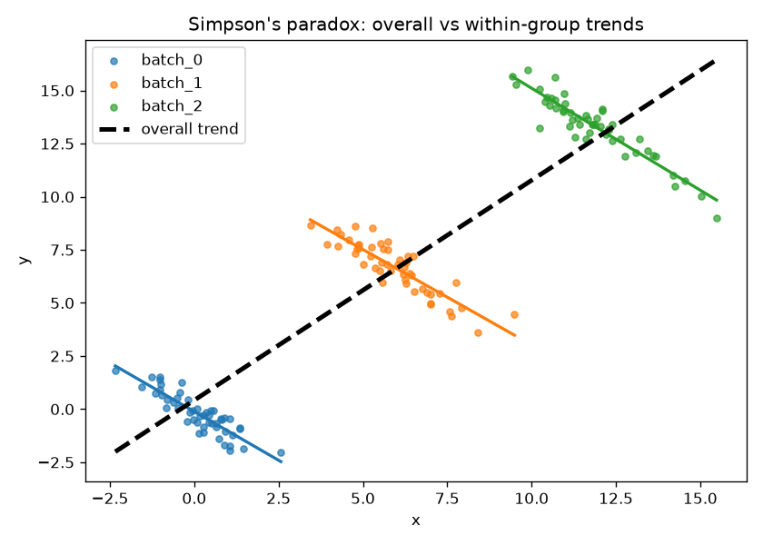

# Simpson's Paradox Sanity Checks

AI will write your DESeq2 script in thirty seconds. It will not tell you that your
"finding" flips sign once you account for the batch you forgot about. That judgement
is still your job, and it is the job that matters now.

This repo is a small, opinionated toolkit of the boring checks that separate a
real result from confident nonsense: Simpson's paradox detection, confounder
screening, and the classic z-score-along-the-wrong-axis blunder.

## Demo Output



The figure above was produced from simulated data by `demo.py`, showing a trend
that reverses once you stratify by a hidden confounder.

## Why This Exists

When code is cheap, the premium is on scope and validation. An agent answers your
question no matter what, and it will happily report a small p-value as a discovery
while ignoring the lurking variable that explains everything. The skills that catch
these errors are not fancy. They are the basics, applied on purpose.

This toolkit encodes three of those basics as runnable functions:

1. **Simpson's paradox** - does an overall correlation reverse within subgroups?
2. **Confounder screening** - is your "biological" variable just tracking batch?
3. **Z-score axis** - were you supposed to normalise rows or columns?

## When NOT to Use This

- This is not a replacement for thinking. It flags suspects, not verdicts.
- It will not rescue a badly framed biological question. If you ran AR binding in a
  breast cancer line because an agent suggested it, no statistic saves you.
- It assumes you can read the output and decide what it means. That is the point.

## Decision Framework

| Symptom | Likely cause | Check to run |
|---|---|---|
| Overall trend looks great, collaborator unconvinced | Hidden subgroup | `detect_simpsons_paradox` |
| Top "hits" all come from one processing batch | Confounding | `screen_confounder` |
| Heatmap looks weird, every gene "the same" | Wrong normalisation axis | `zscore_check` |
| Everything significant at p < 0.05 across 20k tests | No multiple-testing control | apply FDR before celebrating |

## Usage

```bash
pip install -r requirements.txt
python sanity_checks.py          # runs the built-in example
python demo.py                   # self-contained demo, writes figures/ and results/
```

## The Uncomfortable Truth

The AI is not accountable. The person who ran the tool is. A fresh grad who knows
what Simpson's paradox looks like is worth more than an agent that reports every
small p-value as a breakthrough. Learn the basics, because you cannot tell when the
machine is hallucinating if you never knew the right answer yourself.

## Further Reading

Inspired by Ming 'Tommy' Tang, "Is Bioinformatics Doomed? The Future of Bioinformatics in the AI Era" (https://divingintogeneticsandgenomics.com/post/is-bioinformatics-doomed-future-of-bioinformatics-ai/).
